# Multilingual Reasoning Quantization

## 요약
- Gemma MGSM에서는 양자화하면 reasoning에서도 영어, 중자원 언어, 저자원 언어 순으로 더 많이 잃고, 적어도 MXFP4에서는 이 손실이 주로 question을 영어로 옮겨 이해하는 reasoning 앞부분에서 생기는 것으로 보인다.
- Reasoning 시작에 영어 question을 삽입하면 양자화 모델도 영어 외 모든 언어에서 BF16을 넘는다.
- **영어 question과 그 뒤 reasoning을 함께 맞추는 CE_KL QAT로, 삽입 없이도 MXFP4가 영어 외 모든 언어에서 BF16을 넘는다.**

## 배경
대부분의 LLM은 영어 위주의 데이터로 사전학습된다는 점에서, 한국인인 내가 손해를 보고 있는 게 아닐까 하는 단순한 생각에서 이 프로젝트를 시작했다. 이를 우선 가볍게 살펴보고자 다국어 양자화를 다룬 최신 논문 [The Multilingual Quantization Tax](https://arxiv.org/abs/2608.09941)를 읽어 보았는데, 이 논문도 나와 같은 문제를 보았고, 기대대로 저자원 언어가 양자화로 더 크게 잃는다고 말한다. 다만 이 논문은 reasoning을 다루지 않았고 양자화 방법도 하나뿐이라([관련 연구](#관련-연구)), 같은 Gemma와 Qwen에서 thinking mode를 켜고 여러 양자화 방법으로 이를 제대로 확인하고, 손실이 어디서 생기며 어떻게 줄일 수 있는지 방법론까지 살펴본다.

## 관련 연구
#### [The Multilingual Quantization Tax](https://arxiv.org/abs/2608.09941)
- 양자화하면 저자원 언어가 더 많이 잃는다고 보고한다.
- 그러나 thinking mode를 끈 채 객관식 문제만 평가해 reasoning을 다루지 않았고, 양자화 방법도 NF4 하나뿐이다.
- 또한 Gemma와 Qwen의 평균 손실 차이가 1%p도 되지 않는데 Gemma가 superior하다고 쓰는 등 표현이 다소 과장된 면이 있다.
- 이 프로젝트는 thinking mode를 켜고 여러 양자화 방법으로 다시 확인한다.
#### [Why do multilingual reasoning gaps emerge in reasoning language models](https://arxiv.org/abs/2510.27269)
- BF16에서 reasoning 시작에 영어 question을 삽입하면 언어 간 차이가 대부분 사라진다고 보고한다.
- 그러나 양자화 모델은 보지 않았다.
- 이 프로젝트는 같은 방법을 양자화 모델에 적용하고, 삽입 없이 학습으로도 되는지 본다.

## 실험

공통 설정

#### 용어
- BF16은 양자화하지 않은 원래 모델이다.
- Prompt는 instruction과 question, reasoning은 thinking mode에서 쓴 text, response는 reasoning 뒤 text다.
- 손실은 삽입 없는 BF16의 같은 언어 정확도에서 정확도를 뺀 값이다.
- 잘림은 최대 생성 길이에 닿고 틀린 문제다.
- 반복은 reasoning이나 response 끝에서 200~150번째 글자 50개가 그 앞에 5번 이상 나오는 문제다.
#### 모델
- Qwen3.5-2B와 Gemma-4-E2B-it을 thinking mode를 켜고 BF16과 비교한다.
- Language model layer의 linear weight만 4 bit로 양자화한다.
- 양자화 방법은 GPTQ, AWQ, NF4, MXFP4이고, group size는 GPTQ와 AWQ 128, NF4 64, MXFP4 32다.
- GPTQ와 AWQ는 영어 Wikipedia 2048 token chunk 128개로 calibration한다.
#### 생성
- vLLM 0.30.0, temperature 1.0, top-p 0.95다.
- Qwen은 top-k 20, presence penalty 1.5, 최대 생성 길이 32768이다.
- Gemma는 top-k 64, 최대 생성 길이 16384다.
- Seed 0, 1, 2의 평균이다.
#### 평가
- 언어는 영어, 중국어, 일본어, 스와힐리어, 텔루구어이다.
- 한국어는 MMLU-ProX-Lite에는 있지만 MGSM이 지원하지 않아 제외했다.
- MGSM 250문제와 MMLU-ProX-Lite 588문제를 같은 언어 prompt로 zero shot 평가한다.
- Instruction은 [simple-evals](https://github.com/openai/simple-evals/blob/main/mgsm_eval.py)와 [lm-evaluation-harness](https://github.com/EleutherAI/lm-evaluation-harness/blob/main/lm_eval/tasks/mmlu_prox/lang_libs.py)에서 가져온다.
- Response만 채점한다.
#### 학습
- 학습할 언어는 영어를 제외한 중국어, 일본어, 스와힐리어, 텔루구어이다.
- 학습 데이터는 GSM8K train이고, 영어 외 언어 question은 MCoT 번역이다.
- 양자화 대상과 같은 linear weight만 업데이트한다.
- Optimizer는 AdamW(weight decay 0), learning rate는 1e-5에서 warmup 비율 0.05의 cosine schedule이다.
- Batch size 8로 1 epoch 학습한다.

### 언어별 손실
> Reasoning에서도 양자화하면 영어 외 언어가 더 많이 잃는지 확인한다.
- **Gemma는 MGSM 같은 수학 추론 문제에서 영어, 중자원 언어(중국어, 일본어), 저자원 언어(스와힐리어, 텔루구어) 순으로 더 많이 잃고, MXFP4에서 특히 크다.**
- MMLU-ProX-Lite 같은 전문 지식 문제에서는 영어 외 언어가 영어보다 눈에 띄게 더 잃지 않는다.
- Qwen은 양자화하면 잘림과 반복이 늘어 언어와 상관없이 크게 잃는다.
- 따라서 이후 실험은 언어 차이가 뚜렷한 Gemma MGSM만 사용한다.

그림 및 설정

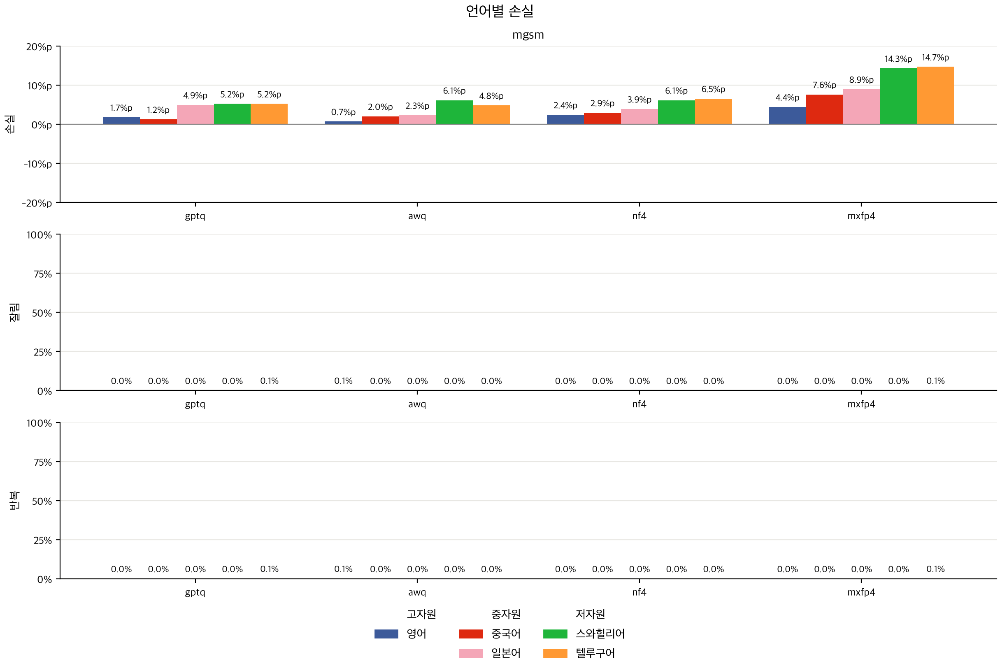
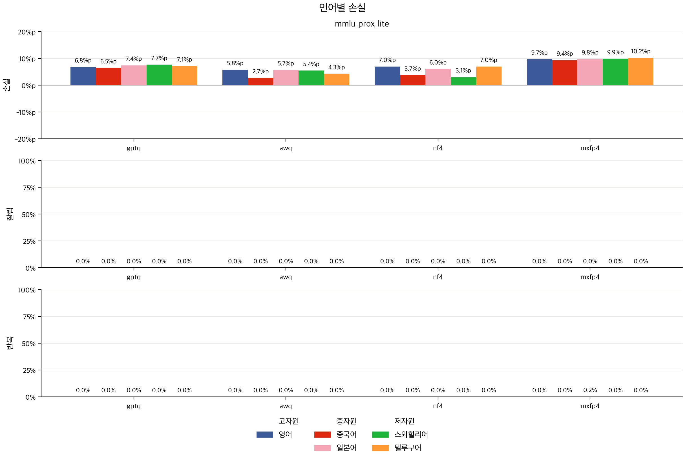
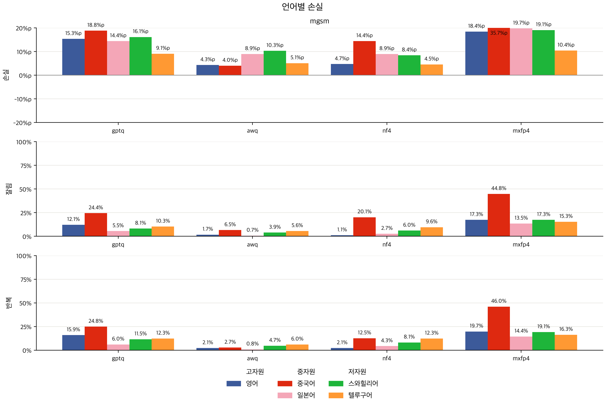
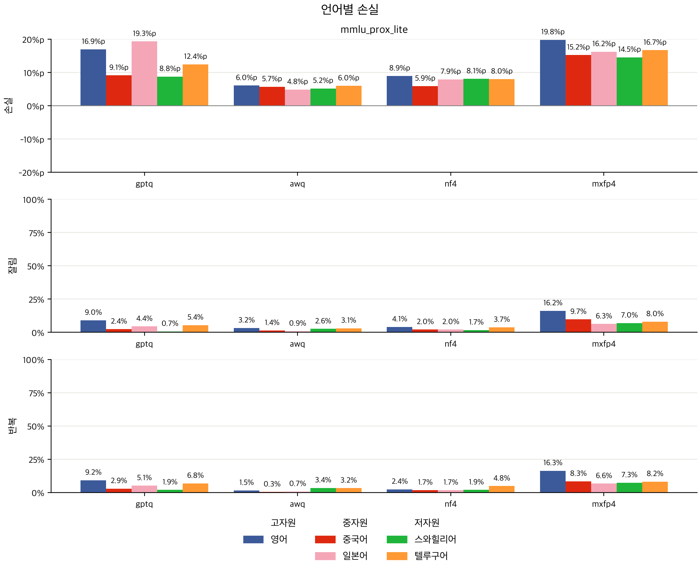
- MMLU-ProX-Lite는 BF16 seed 0, 1과 양자화 모델 seed 0만 사용한다.
- BF16 seed 0과 1의 차이가 작아 나머지 seed는 건너뛰었다.

### Calibration 언어별 손실
> GPTQ와 AWQ는 calibration 데이터를 이용해 양자화 오차를 줄인다.
> 영어로만 calibration해서 영어 외 언어가 더 잃었을 수 있어, 영어 외 언어로도 calibration해 손실을 확인한다.
- 스와힐리어, 텔루구어, 다섯 언어 혼합으로 calibration해도 저자원 언어의 손실이 눈에 띄게 줄지 않는다.
- **따라서 calibration 언어는 손실의 원인이 아니다.**

그림 및 설정

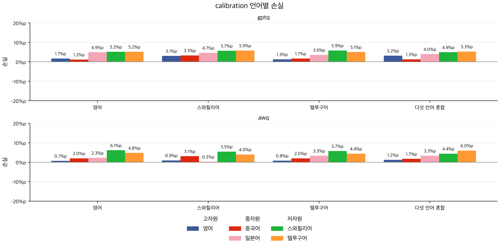
- Calibration 언어는 영어, 스와힐리어, 텔루구어, 다섯 언어 혼합이다.

### Reasoning 위치별 KL
> 원인을 단계별로 좁히기 위해, 먼저 손실이 어디서 생기는지 본다.
> 같은 BF16 reasoning을 BF16과 양자화 모델에 teacher forcing으로 넣어, 다음 token 예측이 reasoning의 어디서 가장 달라지는지 확인한다.
- 모든 양자화 방법에서 손실이 가장 컸던 저자원 언어의 KL이 대부분 가장 크다.
- 저자원 언어와 영어의 KL 차이는 reasoning 앞 20%에서 가장 크다.
- **따라서 손실은 reasoning 앞부분에서 생길 수 있다.**

그림 및 설정

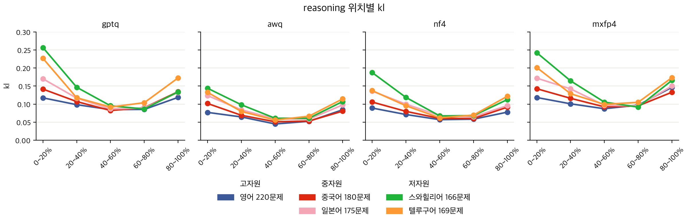
- Reasoning 위치는 문제마다 reasoning token을 5등분한 구간이다.
- BF16 reasoning은 seed 0만 사용한다.
- 문제는 모든 BF16 seed가 맞힌 문제만 사용한다.

### 오류 유형
> 앞선 실험에서 어디서 달라지는지 봤다면, 여기서는 어떻게 틀리는지 본다.
> 손실이 가장 큰 MXFP4가 틀린 reasoning을 판정 모델로 읽어 오류 유형을 대략 나눈다.
- 중자원, 저자원 언어의 오류는 대부분 사실 오류와 관계 오류다.
- 반면 계산 오류는 거의 없다.
- **따라서 reasoning 앞부분에서 question을 잘못 이해해서 틀린 것일 수 있다.**

그림 및 설정

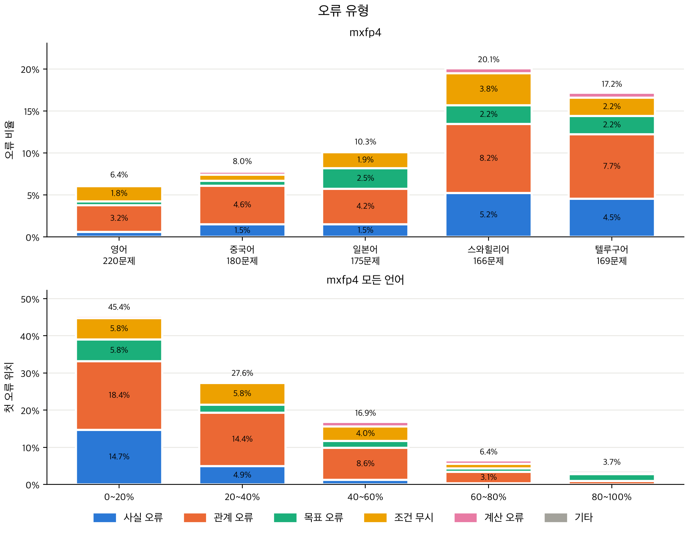
- 판정 모델 Qwen3.5-27B는 영어 question, 정답, BF16 reasoning을 함께 보고 MXFP4 reasoning에서 처음 틀린 줄과 오류 유형을 고른다.
- 판정은 모든 BF16 seed가 맞히고 MXFP4가 틀린 문제만 한다.
- 사실 오류: question의 숫자, 단위, 단어, 이름을 잘못 옮김
- 관계 오류: 양 사이의 관계를 잘못 이해함
- 목표 오류: 묻는 것과 다른 양을 구함
- 조건 무시: 주어진 조건을 없다고, 애매하다고, 또는 상관없다고 보고 버림
- 계산 오류: 식은 맞지만 계산이 틀림
- 기타: 위에 없거나 판정을 읽지 못함
- 오류 비율은 모든 BF16 seed가 맞힌 문제 중 MXFP4가 그 유형으로 틀린 비율이다.
- 첫 오류 위치는 모든 언어의 첫 오류 중 그 reasoning 위치에 있는 비율이다.

### Understanding 삽입
> 한편 Gemma의 reasoning을 뜯어보면 영어 외 언어 prompt에도 영어로 쓰고, question을 영어로 옮겨 이해하는 understanding 부분과 그 뒤에 푸는 solving으로 나뉜다.
> 그렇다면 understanding만 BF16의 것으로 바꿔도 손실이 회복될 것이다.
> BF16 understanding을 양자화 모델의 reasoning 시작에 삽입하고 이어 생성해 손실을 비교한다.
- **MXFP4는 모든 언어에서 손실이 절반 넘게 회복된다.**
- 저자원 언어가 영어보다 더 잃는 정도도 크게 줄어든다.
- 다만 GPTQ, AWQ, NF4는 원래 손실이 작아 뚜렷하게 줄지 않는다.
- 적어도 MXFP4에서는 양자화 후 저자원 언어의 손실이 주로 question을 영어로 옮기는 understanding에서 생기는 것으로 보인다.

그림 및 설정

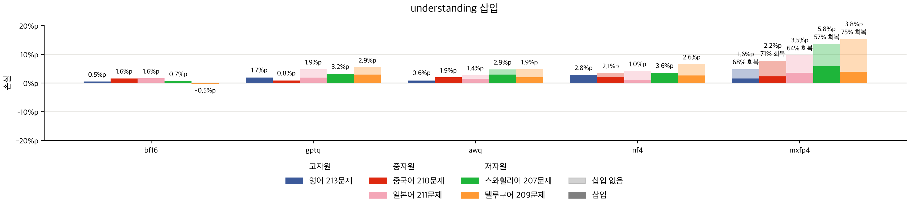
- Understanding은 reasoning에서 번호 붙은 단계 제목에 calculate, determine, compute, solve, perform, set up, formulate가 처음 나오는 단계 앞까지다.
- 삽입한 understanding은 같은 seed의 BF16이 같은 언어 prompt에 쓴 것이다.
- 문제는 영어 understanding 삽입과 같게, 같은 언어와 영어 BF16 reasoning 모두에 understanding이 있는 문제만 사용한다.

### Reasoning 앞부분 길이별 삽입
> Understanding 삽입으로 손실이 회복됐지만, understanding 내용 덕분이 아니라 BF16 reasoning 일부를 삽입한 것만으로 생긴 결과일 수도 있어 이를 확인한다.
> BF16 reasoning 앞부분을 understanding 길이의 0.5배부터 2배까지 여러 길이로 잘라 삽입한다.
> 내용 덕분이면 understanding이 끝나는 1배에서 손실이 뚝 떨어지고, 길이 덕분이면 길수록 고르게 줄어야 한다.
- MXFP4 스와힐리어와 영어는 1배에서 손실이 가장 크게 줄어든다.
- 다만 MXFP4 일본어와 텔루구어는 길수록 고르게 줄어든다.
- GPTQ, AWQ, NF4는 손실이 작아 길이에 따른 차이가 뚜렷하지 않다.
- **따라서 MXFP4에서는 일부 언어의 회복이 understanding 내용 덕분일 수 있지만, 다른 양자화 방법에서는 가리지 못한다.**

그림 및 설정

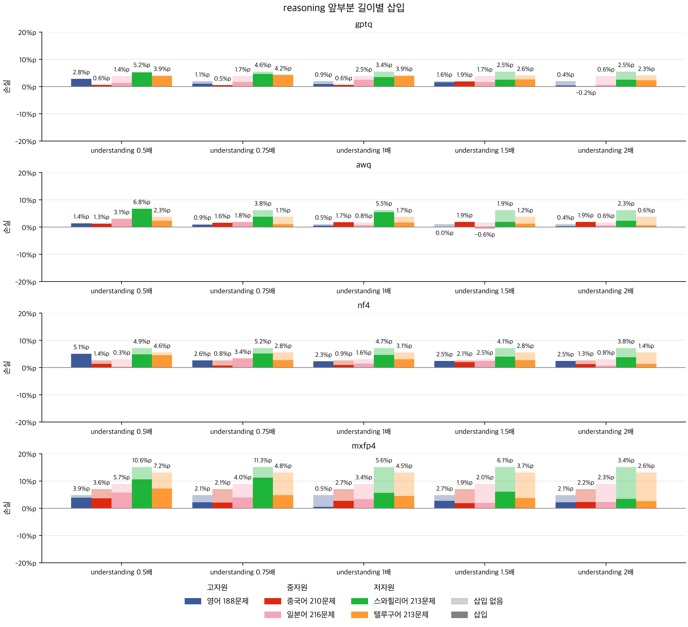
- 자르는 길이는 understanding token 수의 0.5, 0.75, 1, 1.5, 2배다.
- 문제는 reasoning이 understanding token 수의 2배 이상인 문제만 사용한다.

### 영어 understanding 삽입
> BF16 understanding 삽입으로 손실이 회복되긴 했다.
> 그렇다면 영어 외 언어를 영어로 옮겨 이해할 때 생기는 번역 손실이 없다면 더 좋아질까?
> 이를 위해 마치 영어 question을 읽은 것처럼, 영어만큼 잘 이해한 understanding을 넣어 더 회복되는지 확인한다.
> 영어 외 언어 question을 prompt로 주고, reasoning 시작에 BF16이 영어 prompt에 쓴 understanding을 붙여 BF16과 양자화 모델이 이어 생성하게 한다.
- **모든 양자화 방법에서 영어 외 모든 언어가 BF16을 넘는다(삽입 없는 BF16보다 정확도가 높다).**
- BF16도 영어 외 언어에서 크게 오른다.
- 의아한 건 손실이 가장 컸던 MXFP4가 다른 양자화 방법보다 덜 오른다는 것이다.
- 따라서 양자화 모델은 푸는 능력보다 영어 외 언어를 이해하는 능력을 주로 잃으며, 이를 고려한 양자화 방법이 필요할 수 있다.

그림 및 설정

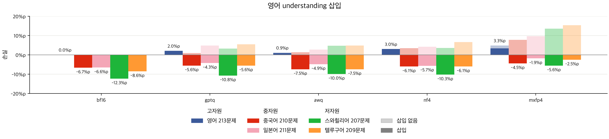
- 문제는 [Understanding 삽입](#understanding-삽입)과 같다.

### 영어 understanding finetune
> 앞선 실험에서 영어 외 언어를 영어로 옮겨 이해하는 능력이 중요했다.
> 그렇다면 이 능력을 학습시키기 위해, 우선 양자화 손실과 섞이지 않게 BF16을 finetune해 확인한다.
> 영어 외 언어 prompt 뒤의 understanding이나 reasoning이, 영어 prompt를 받은 BF16의 것과 같아지도록 finetune한다.
- **Understanding을 맞추는 finetune은 모두 영어 외 언어에서 오히려 BF16보다 잃는다.**
- Reasoning 전체를 맞추는 대조군 KL on policy reasoning이 가장 좋다.
- 의아한 결과지만, 생각해 보면 understanding은 Gemma가 생성한 reasoning의 일부라, 우리가 학습시키려는 번역해 이해하는 부분보다 Gemma의 문체가 훨씬 많은 것이 문제일 수 있다.
- 따라서 이해 능력만 학습하려 해도 그 학습 신호가 적어 잘 학습되지 않을 수 있다.

그림 및 설정

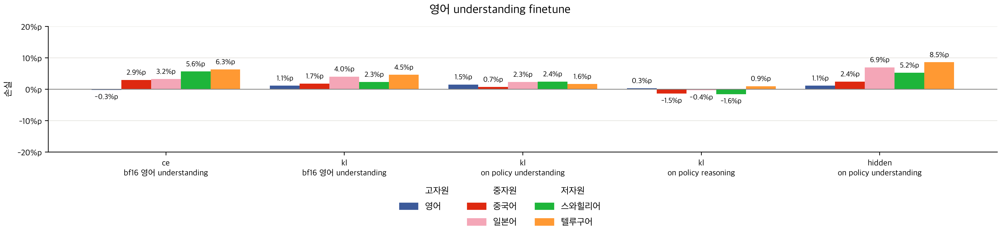
- 막대 이름은 finetune loss와 맞출 text다.
- CE는 BF16 영어 understanding을 정답으로 다음 token을 맞춘다.
- KL은 같은 text를 영어 prompt 뒤에 받은 BF16의 다음 token 예측에 맞춘다.
- Hidden은 같은 text를 영어 prompt 뒤에 받은 BF16의 layer마다 hidden에 cosine 유사도로 맞춘다.
- BF16 영어 understanding은 BF16이 영어 prompt에 쓴 understanding이다.
- On policy는 finetune 중인 모델이 같은 언어 prompt에 쓴 understanding이나 reasoning이다.
- 학습 데이터는 GSM8K train 4000개로, BF16이 영어와 같은 언어로 모두 맞힌 문제만 쓴다.

### 영어 question 삽입
> 앞서 말했듯 understanding에는 문체가 섞여 있어 이해 능력만 따로 학습하기 어려웠다.
> 그렇다면 문체 없이 이해에 필요한 내용만 담고 번역 오류도 없는, 순수한 학습 신호인 영어 question을 넣으면 어떨까?
> 이를 학습 방법으로 다루기 전에, 이런 방식이 효과가 있는지 먼저 삽입으로 알아본다.
> [Why do multilingual reasoning gaps emerge in reasoning language models](https://arxiv.org/abs/2510.27269)처럼 영어 외 언어 question을 prompt로 주고, reasoning 시작에 같은 문제의 영어 question을 붙여 BF16과 양자화 모델이 이어 생성하게 한다.
- **모든 양자화 방법에서 영어 외 모든 언어가 BF16을 넘는다.**
- BF16도 크게 오르고, 저자원 언어에서 특히 많이 오른다.
- 게다가 영어 understanding 삽입보다도 대부분 더 크게 넘는다. Solving 단계에서 대부분 understanding에 attention하지만 question도 아예 보지 않는 것은 아니라서, 영어 외 언어 question 대신 삽입한 영어 question을 참고하면서 더 좋아진 것이 아닐까 생각해 본다.

그림 및 설정

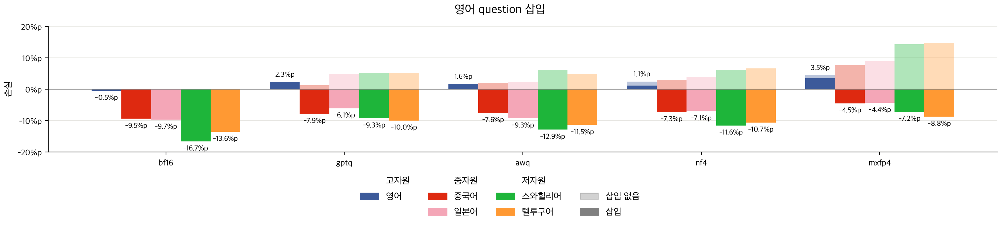
- 관련 연구와 달리 문장으로 감싸지 않고 영어 question만 삽입한다.

### 영어 question finetune
> 영어 question 삽입은 기대한 대로 효과가 컸다.
> 그렇다면 더 순수한 학습 신호인 영어 question으로 실제로 학습이 되는지, 이전과 같이 BF16을 finetune해 확인한다.
> 영어 외 언어 prompt 뒤 reasoning 시작에 영어 question을 쓰도록 finetune한다. CE는 영어 question만 맞추고, CE_KL은 BF16이 영어 question 삽입 뒤에 쓴 reasoning까지 KL로 함께 맞춘다.
- CE는 영어 외 언어에서 대부분 잘리고 반복하며 무너진다.
- 영어 question이 기존 문체와 달라, 이를 학습하면서 그 뒤 reasoning까지 무너뜨린 것일 수 있다.
- 그래서 그 뒤 reasoning도 함께 맞추는 CE_KL이 필요했다.
- **그랬더니 CE_KL은 20000 sample부터 삽입 없이도 영어 외 모든 언어에서 BF16을 넘었다.**
- 따라서 영어 question을 쓰도록 학습하면서, 그 뒤 reasoning을 유지하는 것이 중요하다.

그림 및 설정

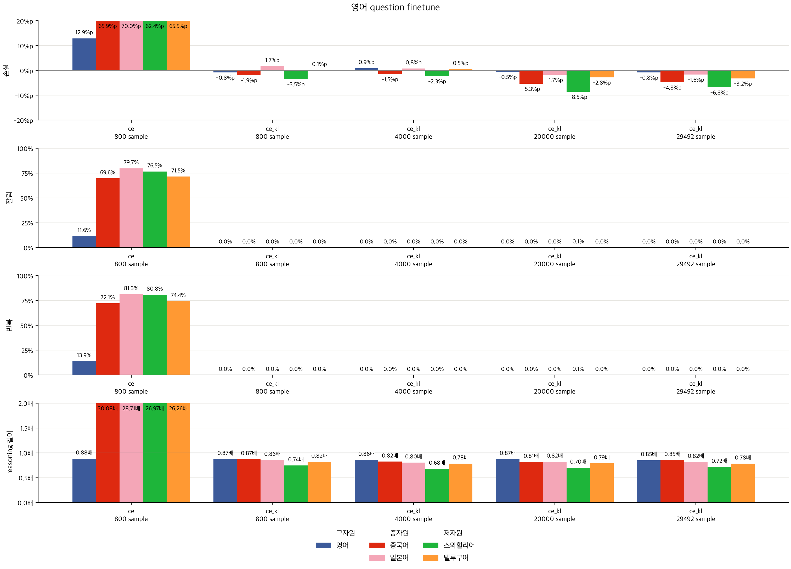
- 학습 데이터는 GSM8K train에서 reasoning이 2048 token 미만인 29492개다.
- CE_KL의 reasoning은 BF16이 영어 question 삽입으로 쓴 것이다.
- Sample 수는 지금까지 finetune한 학습 데이터 수다.
- 800, 4000, 20000 sample은 학습 데이터 중 같은 20000개를 같은 순서로 finetune한 중간 결과다.
- CE는 learning rate warmup 중인 800 sample에서 이미 무너져 800 sample만 평가했다.
- 29492 sample은 학습 데이터를 모두 finetune한 것이다.
- Reasoning 길이는 언어마다 reasoning token 수 중앙값의 BF16 대비 배다.

### QAT
> 앞의 실험에서 영어 question을 쓰도록 학습하면 언어 이해가 좋아지는 것을 보았다.
> 이제 원래 목표였던 양자화 모델로 돌아가, 손실을 회복하는 것을 넘어 BF16까지 넘을 수 있는지 확인한다.
> CE_KL finetune한 BF16을 그대로 MXFP4로 양자화한 것과, MXFP4로 양자화한 채 CE_KL로 학습하는 CE_KL QAT를 비교한다.
> 대조군으로, 영어 question 없이 같은 언어 reasoning만 BF16에 KL로 맞추는 KL QAT도 비교한다.
- CE_KL finetune을 그대로 MXFP4로 양자화하면 모든 언어에서 다시 잃는다.
- 대조군 KL QAT는 MXFP4 손실을 대부분 회복하지만 BF16을 넘지 못한다.
- **CE_KL QAT는 삽입 없이도 영어 외 모든 언어에서 BF16을 넘는다.**
- 따라서 양자화 모델이 BF16을 넘는 것은 손실을 회복해서가 아니라 영어 question을 쓰도록 학습한 덕분이다.

그림 및 설정

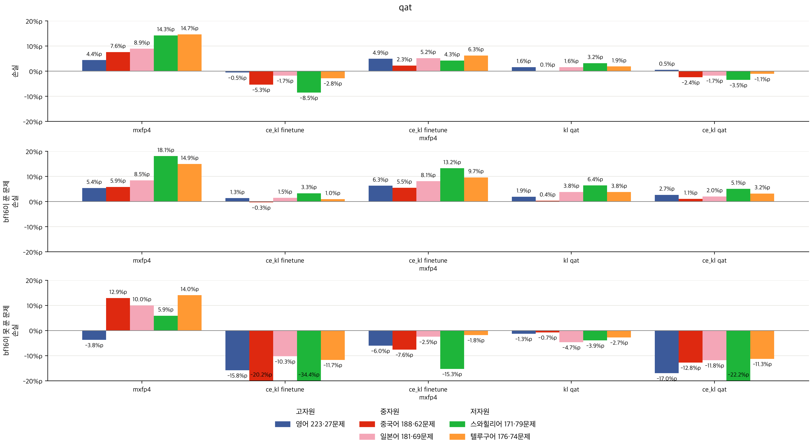
- QAT는 forward에 MXFP4로 양자화한 weight를 쓰고, backward는 양자화를 건너뛰어 원래 weight를 업데이트한다.
- KL QAT 학습 데이터는 BF16이 GSM8K train의 같은 언어 question에 쓴 reasoning 중 2048 token 미만인 20000개다.
- CE_KL QAT 학습 데이터는 영어 question finetune의 20000개와 같다.

## 한계와 할 것
- 언어별 손실 뒤 실험은 Gemma MGSM만 써서, 다른 benchmark와 다른 모델에서도 같은 결과가 나오는지 확인한다.
- 다국어 reasoning이나 양자화 회복을 다룬 다른 방법을 대조군으로 두고 CE_KL QAT와 비교한다.
  - [Crosslingual On-Policy Self-Distillation for Multilingual Reasoning (COPSD)](https://arxiv.org/abs/2605.09548)
  - [Language-Conditional Dequantization: Recovering What Quantization Steals from Non-English Languages](https://arxiv.org/abs/2608.11786)
  - [Align to the Pivot: Dual Alignment with Self-Feedback for Multilingual Math Reasoning (PASMR)](https://arxiv.org/abs/2601.17671)
